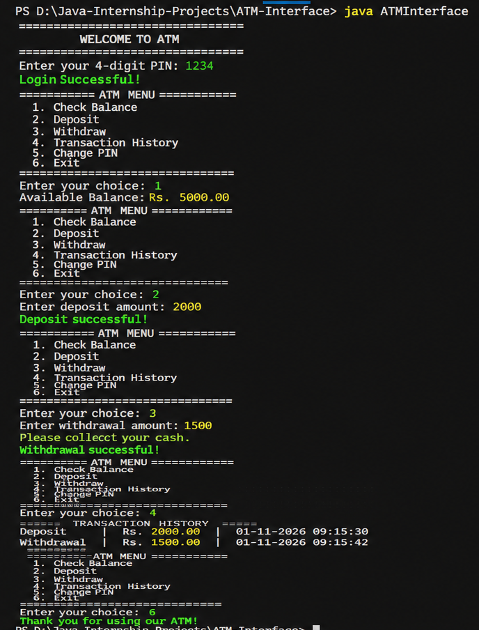
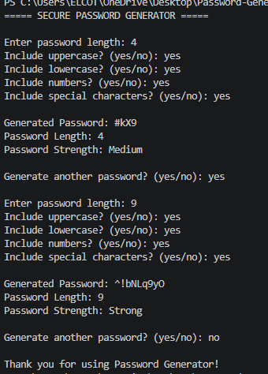

# 🚀 SAM AI Tech Task – Java Programming Internship

This repository contains three Java programming projects completed as part of the **SAM AI Technologies Internship**.

---

# 🏧 TASK 1 – ATM Interface System

A console-based ATM Simulation System developed using **Java** and **Object-Oriented Programming (OOP)** concepts. This project simulates basic ATM banking operations with PIN authentication and transaction management.

## ✨ Features

- 🔐 PIN-based Login Authentication
- 💰 Check Account Balance
- 💵 Deposit Money
- 💸 Withdraw Money
- 📋 View Transaction History
- 🔑 Change ATM PIN
- ⚠️ Input Validation
- 🛡️ Insufficient Balance Validation
- 🔒 Account Lock After Three Incorrect PIN Attempts

## 🛠️ Technologies Used

- Java
- Object-Oriented Programming (OOP)
- ArrayList
- Scanner Class
- Java Date and Time API

## ▶️ How to Run

Compile the Java files:

```bash
javac ATMInterface.java BankAccount.java Transaction.java
```

Run the program:

```bash
java ATMInterface
```

## 🧠 OOP Concepts Used

- **Encapsulation:** Protecting account details using private variables.
- **Classes and Objects:** Separating ATM, bank account, and transaction responsibilities.
- **Methods:** Implementing individual banking operations.

## 📸 Sample Output

 (mention above )


---

# 🎮 TASK 2 – Number Guessing Game

A simple and interactive Java-based Number Guessing Game that challenges players to guess a randomly generated secret number between **1 and 100**.

The game provides helpful hints and motivational messages to make the experience fun and engaging.

## 🎯 Project Objective

To develop a console-based Java application using random number generation, conditional statements, loops, and user input.

## ✨ Features

- 🎲 Random number generation (1–100)
- 🔢 Interactive user input
- 📈 Too High and Too Low hints
- 💪 Motivational messages
- 🏆 Congratulations message on winning
- 🎯 Total attempts counter

## 🛠️ Technologies Used

- Java
- Scanner Class
- Random Class
- Visual Studio Code

## ▶️ How to Run

Compile the program:

```bash
javac -encoding UTF-8 NumberGuessingGame.java
```

Run the program:

```bash
java NumberGuessingGame
```

## 📸 Sample Output


## 🧠 Concepts Used

- Classes and Objects
- Scanner for user input
- Random number generation
- If-Else conditional statements
- Do-While loop
- Variables and operators

---

# 🔐 TASK 3 – Secure Password Generator

A Java-based Secure Password Generator that creates random passwords using user-selected character types.

## ✨ Features

- 🔑 Generate random passwords
- 📏 Customize password length
- 🔠 Include uppercase letters
- 🔡 Include lowercase letters
- 🔢 Include numbers
- 🔣 Include special characters
- 🛡️ Uses SecureRandom for secure generation
- 💪 Password strength checker (Weak, Medium, Strong)
- 🔄 Generate multiple passwords
- ⚠️ Input validation

## 🛠️ Technologies Used

- Java
- SecureRandom
- ArrayList
- StringBuilder
- Collections
- Scanner

## ▶️ How to Run

Compile the program:

```bash
javac PasswordGenerator.java
```

Run the program:

```bash
java PasswordGenerator
```

## 🧠 Java Concepts Used

- Classes and Methods
- Loops and Conditional Statements
- Strings and StringBuilder
- ArrayList and Collections
- SecureRandom
- Input Validation

## 📸 Sample Output


---

# 🎯 Learning Outcomes

Through these projects, I gained practical experience in:

- Java Programming
- Object-Oriented Programming
- Random Number Generation
- User Input Handling
- Input Validation
- Java Collections
- Secure Programming Concepts
- Console-Based Application Development

---

## 👩‍💻 Author

**Durgalakshmi M**

GitHub: [durgalakshmim-2007](https://github.com/durgalakshmim-2007)

---

⭐ Thank you for visiting my Java Internship Projects!
